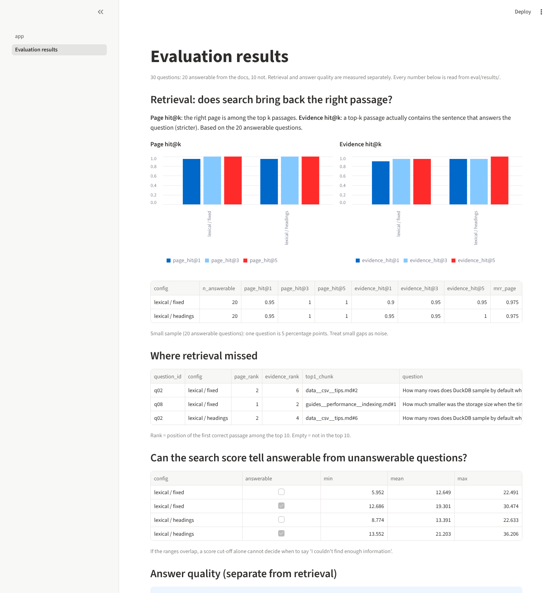

# DuckDB Docs Assistant: a document assistant that shows its sources

A retrieval-augmented generation (RAG) system that answers questions about 20 pages of the DuckDB documentation. It shows the passages it used next to the answer, links every source page, and says **"I couldn't find enough information"** when the documents don't contain the answer.

The chatbot is the smaller half of this project. The larger half is the **evaluation**: 30 questions written before any tuning (10 of them deliberately not answerable from the documents), retrieval measured separately from answer quality, and two chunking strategies compared on the same questions. Every number below is generated from files in `eval/results/`. Nothing is estimated.



*The screenshot is from the keyword-search run only. Re-take it after running the dense-retrieval evaluation.*

## Status: what has and has not been run

| Part | State |
|---|---|
| Page cleaning, chunking (2 strategies), keyword search (BM25), embedding search (Chroma), cited-answer generation, evaluation scripts, Streamlit app | Built. 38 automated tests pass. |
| Embedding search | Tested with fake embeddings only (proves the Chroma code works, says nothing about quality). **Not yet run with the real embedding model.** |
| Answer generation | Tested with a fake model client (parsing, citation checking, refusal handling). **Not yet run against the real API.** |
| Retrieval evaluation | **Run for keyword search** (both chunking strategies). Dense run pending. |
| Answer evaluation | **Not run yet.** Needs an Anthropic API key. Correctness needs human labels. |
| Power BI report | Data export and build guide are in `powerbi/`. The report itself is not built yet. |

## Results

<!-- RESULTS:START -->
### Retrieval (no LLM involved)

Share of the 20 answerable questions where the right passage came back in the top k. **Page** = the right page is in the top k. **Evidence** = a top-k passage contains the sentence that answers the question. One question = 5 percentage points.

| retriever | strategy | page_hit@1 | page_hit@3 | page_hit@5 | evidence_hit@1 | evidence_hit@3 | evidence_hit@5 | mrr_page |
|---|---|---|---|---|---|---|---|---|
| lexical | fixed | 0.95 | 1 | 1 | 0.9 | 0.95 | 0.95 | 0.975 |
| lexical | headings | 0.95 | 1 | 1 | 0.95 | 0.95 | 1 | 0.975 |

> Dense (embedding) retrieval has **not been run yet** in this repo version, so only the keyword baseline is reported. Run `python eval/run_retrieval_eval.py` to add it.

### Chunking strategies

| strategy | chunks | min_chars | mean_chars | max_chars | under_200_chars |
|---|---|---|---|---|---|
| fixed | 267 | 31 | 825 | 998 | 5 |
| headings | 318 | 38 | 677 | 1000 | 24 |

### Where retrieval missed at rank 1

| question_id | config | page_rank | evidence_rank | top1_chunk | question |
|---|---|---|---|---|---|
| q02 | lexical / fixed | 2 | 6 | data__csv__tips.md#2 | How many rows does DuckDB sample by default when detecting CSV column types? |
| q08 | lexical / fixed | 1 | 2 | guides__performance__indexing.md#1 | How much smaller was the storage size when the timestamp column was ordered in the microbenchmark? |
| q02 | lexical / headings | 2 | 4 | data__csv__tips.md#6 | How many rows does DuckDB sample by default when detecting CSV column types? |

`page_rank` / `evidence_rank` = position of the first correct passage (empty = not in the top 10).

### Top-1 search score: answerable vs unanswerable questions

| config | answerable | min | mean | max |
|---|---|---|---|---|
| lexical / fixed | False | 5.95 | 12.7 | 22.5 |
| lexical / fixed | True | 12.7 | 19.3 | 30.5 |
| lexical / headings | False | 8.77 | 13.4 | 22.6 |
| lexical / headings | True | 13.6 | 21.2 | 36.2 |

If the ranges overlap, a score cut-off alone cannot decide when to refuse.

### Answer quality (separate from retrieval)

> Answer evaluation has **not been run yet** (it needs an Anthropic API key). No answer-quality numbers are reported.

### Run details

| config | run_at | python | embedding_model | questions |
|---|---|---|---|---|
| lexical/fixed | 2026-11-26T19:01:07+00:00 | 3.13.18 | - | 30 |
| lexical/headings | 2026-11-26T19:01:07+00:00 | 3.13.18 | - | 30 |

<!-- RESULTS:END -->

### What the keyword-search run shows

* **Finding the right page is easy here; finding the right sentence is harder.** Page hit@1 is higher than evidence hit@1 for the fixed-size chunks, because the right page can come back with the wrong part of it. Example: for *"How much smaller was the storage size when the timestamp column was ordered in the microbenchmark?"* the right page ranked first, but the passage holding the "2.5× smaller" sentence ranked second.
* **Competing pages cause real misses.** For *"How many rows does DuckDB sample by default when detecting CSV column types?"* the CSV Tips page has its own "Sample Size" section about *increasing* the sample size, and keyword matching ranked it above the Auto Detection page, which states the default of 20,480 rows. The right passage ranked 4th (heading chunks) or 6th (fixed chunks).
* **A search score alone cannot decide when to refuse.** The top-1 score ranges for answerable and unanswerable questions overlap (see the table above), so the assistant relies on the model to judge whether the passages are enough, and that behaviour is what the answer evaluation is for.

These are observations from 20 questions on one run. One question is 5 percentage points, so small gaps between strategies are within noise.

## How it works

```
20 DuckDB doc pages
   -> clean (strip website template code)          src/docassist/loader.py
   -> chunk (two strategies)                       src/docassist/chunking.py
   -> index and search (BM25 or embeddings+Chroma) src/docassist/retrieve.py
   -> top-k passages
   -> model answers ONLY from them, as JSON:       src/docassist/generate.py
        {"answerable": ..., "answer": ..., "citations": [chunk ids]}
   -> citations are checked against the passages that were actually supplied
   -> app shows answer, sources, and the passages  app.py
```

Chunking strategies (compared on the same questions):

* **fixed**: every ~1000 characters with 150 overlap, ignoring page structure.
* **headings**: split at markdown headings first, then cap section size at 1000 characters. The searched text also gets a breadcrumb ("Page title > Section"), so a chunk from the middle of a long section still carries its context. Note this strategy differs from `fixed` in two ways (boundaries and breadcrumb), so a difference between them cannot be attributed to boundaries alone.

## Quick start

```bash
conda create -n docassist python=3.12 -y && conda activate docassist
python -m pip install -r requirements.txt

python -m pytest tests -q                                   # run the tests
python -m src.docassist.search "what is hive partitioning"  # search only, no LLM
python eval/run_retrieval_eval.py                           # retrieval metrics (first dense run downloads the embedding model)

export ANTHROPIC_API_KEY=...                                # your key, never commit it
python eval/run_answer_eval.py --retriever dense            # answer evaluation (calls the API)
python eval/make_report.py                                  # refresh the results block above
python eval/export_powerbi.py                               # refresh the Power BI data
streamlit run app.py                                        # the app (and an Evaluation results page)
```

The embedding index is stored outside the repo, in `~/.docassist/chroma_db` (override with `DOCASSIST_CHROMA_DIR`). The Python version is 3.12; I could not install the dependencies on Python 3.14.

## Repo layout

| Path | What it is |
|---|---|
| `corpus/docs/` | 20 unmodified DuckDB doc pages, pinned to one commit (see `NOTICE.md`) |
| `src/docassist/` | loader, chunking, retrieval, generation, search CLI |
| `app.py`, `pages/` | Streamlit app and results page |
| `eval/questions.jsonl` | the 30 questions with gold pages and exact evidence sentences |
| `eval/verify_questions.py` | proves every answer sentence is in the docs and every "unanswerable" topic is absent |
| `eval/run_retrieval_eval.py`, `run_answer_eval.py` | the two evaluations, kept separate on purpose |
| `eval/results/` | raw per-question results and the generated `REPORT.md` |
| `powerbi/` | data exports and a build guide for a Power BI dashboard |
| `docs/HOW_IT_WORKS.md` | plain-language walkthrough of the code and the decisions |
| `tests/` | automated tests |

## Design decisions

1. **Pinned corpus.** The 20 pages come from one commit of the DuckDB docs repository, so anyone can reproduce the results. The overlap between pages is deliberate (3 CSV, 2 Parquet, 6 performance pages) so retrieval must choose the right page, not any page on the topic.
2. **Cleaning the website source.** The pages are Jekyll files. The loader removes the YAML header (keeping only the title), converts `[text]()` to `text`, and removes image tags, Kramdown styling like `{:.language-sql .highlight}`, and HTML comments. `{{ site.latest_duckdb_version }}` is replaced by the fixed text `2.0.1` (a stand-in, not looked up from DuckDB's site configuration); deleting it would leave a broken sentence. Tests check that no template syntax is left.
3. **A keyword baseline next to embedding search.** BM25 needs no model and gives a reference point. If embeddings do not beat it, that is worth knowing.
4. **Evidence-level metrics, not just page-level.** "Right page" can hide "wrong part of the page", so each answerable question carries an exact sentence that a retrieved passage must contain. `verify_questions.py` checks those sentences exist in the pages.
5. **Unanswerable questions tested against the documents, not the world.** A question can be about something DuckDB really does elsewhere (for example reading Excel files) and still be unanswerable here, because these 20 pages never mention it. The correct behaviour is to refuse.
6. **Structured answers with checked citations.** The model replies in JSON and cites passage ids. Citations that were not among the supplied passages are dropped and reported, and an answer with no valid citation is flagged in the app.
7. **Retrieval and answer quality are separate evaluations.** Each answer is classified as `retrieval_miss_refused`, `retrieval_miss_answered`, `wrongly_refused`, `answered`, `correct_refusal` or `should_have_refused`, which separates "search failed" from "the model failed". Whether an answer is correct is a human judgement and is reported only from rows that have been labelled.
8. **Python 3.12.** Installing the splitter on Python 3.14 failed with a dependency conflict, so the project uses 3.12.

## Limitations

* **The questions share vocabulary with the pages.** They were drafted by reading the pages, then verified by script. That favours keyword matching and probably flatters every retriever. A fairer test adds questions written without the page open.
* **Small sample.** 20 answerable and 10 unanswerable questions.
* **Evidence matching is a string match.** A passage that states the fact in different words counts as a miss.
* **Generated answers vary** between runs (no fixed random seed), and results depend on the model named in `eval/results/run_info.json` and in the answer results.
* **Source links** point to `duckdb.org/docs/stable/...`, which may move ahead of the pinned 2.0 pages.
* **Not built:** reranking, hybrid keyword+embedding search, query rewriting, retries or branching (the natural next step is LangGraph, once there is something to branch on).

## How this was built

Built with Claude (Anthropic) as a coding assistant. The 30 questions were drafted with Claude and checked against the documents by `eval/verify_questions.py`.

## Credits

Documentation text is from the DuckDB documentation (MIT licence). See `NOTICE.md`.
